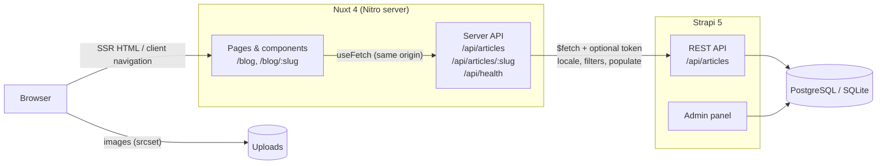

# Nuxt Strapi Starter

[](https://github.com/bartlomiejw/nuxt-strapi-starter/actions/workflows/ci.yml)
[](./LICENSE)

A production-minded starter for content-driven websites: a server-rendered **Nuxt 4** front end backed by a headless **Strapi 5** CMS, with PrimeVue, Tailwind CSS, localisation (including right-to-left), error monitoring and a complete test and CI setup.

## Why

Most starters stop at "hello world". This one covers the parts that usually get postponed:

- **A real CMS integration** – typed data fetching, localised content and responsive images, not a schema dump.
- **Failure handling** – when Strapi is down the site still renders and tells the visitor what happened (with the right HTTP status for crawlers).
- **Quality gates** – linting, type checking, unit/component tests, end-to-end tests and CI that runs all of them on every pull request.

## Features

- Nuxt 4 SSR with the `app/` directory structure and types shared between client and server
- Strapi 5 `Article` collection type with seed data, consumed over REST through a small Nitro API layer
- Blog list and article pages with loading, empty, not-found and "CMS unavailable" states
- PrimeVue 4 components themed with a customised Aura preset; Tailwind CSS 4 for layout
- `@nuxtjs/i18n` with English, French, Polish and Arabic (RTL), SEO-friendly `hreflang`/canonical links
- Dark mode (system / light / dark), cookie consent, Iconify icons via `@nuxt/icon`, self-hosted Google Fonts
- Pinia store example (blog layout preference persisted in a cookie, so SSR renders it)
- Optional Sentry error monitoring – a no-op until a DSN is configured
- `/api/health` endpoint reporting app and CMS status
- Vitest + `@nuxt/test-utils` and Playwright; ESLint flat config; Husky, lint-staged and commitlint
- Docker images for both apps and a `docker-compose.yml` with PostgreSQL

## Stack

| Area            | Technology                                                                                  |
| --------------- | ------------------------------------------------------------------------------------------- |
| Framework       | [Nuxt 4](https://nuxt.com) (Vue 3, Nitro, Vite)                                             |
| CMS             | [Strapi 5](https://strapi.io) (PostgreSQL in Docker, SQLite locally)                        |
| UI              | [PrimeVue 4](https://primevue.org) (Aura preset), [Tailwind CSS 4](https://tailwindcss.com) |
| i18n            | [@nuxtjs/i18n](https://i18n.nuxtjs.org) – `en`, `fr`, `pl`, `ar` (RTL)                      |
| State           | [Pinia](https://pinia.vuejs.org)                                                            |
| Monitoring      | [@sentry/nuxt](https://docs.sentry.io/platforms/javascript/guides/nuxt/)                    |
| Testing         | [Vitest](https://vitest.dev), [@nuxt/test-utils](https://nuxt.com/docs/getting-started/testing), [Playwright](https://playwright.dev) |
| Tooling         | TypeScript, [@nuxt/eslint](https://eslint.nuxt.com), Husky, lint-staged, commitlint         |
| Runtime         | Node.js 22 LTS, pnpm via Corepack                                                           |

## Architecture



- Pages call **same-origin** Nuxt server routes through typed composables (`useArticles`, `useArticle`). Only the server talks to Strapi, so an API token never reaches the browser and CORS is not needed for data.
- `server/utils/strapi.ts` maps failures to predictable errors: Strapi unreachable → `503`, upstream error → `502`, missing article → `404`. Pages render a matching state and set the same status during SSR.
- Responses are normalised (`shared/utils/strapi.ts`) into small typed shapes shared by client and server; media URLs become absolute and Strapi image formats become a `srcset`.
- The active i18n locale is sent to Strapi, so content is served in the visitor's language. Article slugs are shared across locales, which keeps the language switcher working on article pages.

```text
app/              Nuxt application (pages, layouts, components, composables, stores)
server/           Nitro server routes and the Strapi client
shared/           Types and pure helpers used by both app and server
i18n/locales/     Translation files
strapi/           Strapi 5 CMS (content type, seed data, Dockerfile)
tests/            unit/ (Node), nuxt/ (Nuxt runtime), e2e/ (Playwright)
```

## Quick start

Requirements: Node.js 22 LTS (`nvm use`) and Corepack (`corepack enable`). Docker is optional.

### Front end only (no CMS)

```bash
git clone https://github.com/bartlomiejw/nuxt-strapi-starter.git
cd nuxt-strapi-starter
pnpm install
pnpm dev
```

Open http://localhost:3000. Everything works; `/blog` shows a "content service unavailable" message until Strapi is running.

### With Strapi (Docker)

```bash
docker compose up -d   # PostgreSQL + Strapi on http://localhost:1337
pnpm dev               # Nuxt on http://localhost:3000
```

On first start Strapi seeds demo articles in all four languages and grants public read access. Create an admin account at http://localhost:1337/admin to edit content.

To run the production Nuxt build in Docker as well:

```bash
docker compose --profile web up -d --build
```

> The compose file ships with development-only secrets. For anything public, copy `strapi/.env.example` to `strapi/.env` and set real values.

### With Strapi (without Docker)

```bash
cd strapi
cp .env.example .env   # replace the "tobemodified" values
pnpm install
pnpm develop
```

## Environment variables

Copy `.env.example` to `.env`. All variables are optional for local development.

| Variable                                            | Default                 | Description                                                             |
| --------------------------------------------------- | ----------------------- | ----------------------------------------------------------------------- |
| `NUXT_STRAPI_URL`                                   | `http://localhost:1337` | Strapi URL used by the Nuxt server (use `http://strapi:1337` in Docker) |
| `NUXT_STRAPI_TOKEN`                                 | –                       | Optional read-only Strapi API token, server-side only                   |
| `NUXT_PUBLIC_STRAPI_URL`                            | `http://localhost:1337` | Strapi URL as seen by the browser (media URLs)                          |
| `NUXT_PUBLIC_SITE_URL`                              | `http://localhost:3000` | Canonical site URL for SEO tags                                         |
| `NUXT_PUBLIC_SENTRY_DSN`                            | –                       | Enables Sentry when set                                                 |
| `NUXT_PUBLIC_SENTRY_ENVIRONMENT`                    | `development`           | Sentry environment name                                                 |
| `NUXT_PUBLIC_SENTRY_TRACES_SAMPLE_RATE`             | `0.1`                   | Share of requests traced by Sentry                                      |
| `SENTRY_AUTH_TOKEN`, `SENTRY_ORG`, `SENTRY_PROJECT` | –                       | Build time only: upload hidden source maps to Sentry                    |

Strapi's own variables are documented in [`strapi/.env.example`](./strapi/.env.example).

## Scripts

| Script            | Description                                                 |
| ----------------- | ----------------------------------------------------------- |
| `pnpm dev`        | Start the development server                                |
| `pnpm build`      | Build for production (`.output/`)                           |
| `pnpm preview`    | Preview the production build                                |
| `pnpm start`      | Run the production server (`node .output/server/index.mjs`) |
| `pnpm generate`   | Pre-render a static site                                    |
| `pnpm lint`       | Lint with ESLint (`pnpm lint:fix` to fix)                   |
| `pnpm typecheck`  | Type-check with `nuxt typecheck` (vue-tsc)                  |
| `pnpm test`       | Run unit and component tests with Vitest                    |
| `pnpm test:watch` | Vitest in watch mode                                        |
| `pnpm test:e2e`   | Run Playwright tests against the production build           |

## Testing

- **Unit** (`tests/unit`, Node environment): Strapi response normalisation, media URLs, `srcset`, locale handling.
- **Nuxt runtime** (`tests/nuxt`, `@nuxt/test-utils` + happy-dom): composables, the Pinia store, the rich-text renderer and the blog page with mocked API endpoints (list, empty and unavailable states).
- **End-to-end** (`tests/e2e`, Playwright): the home page renders, the language switcher works (including RTL), and the blog handles Strapi being down with a `503` and a friendly message.

```bash
pnpm test
pnpm build
pnpm exec playwright install chromium   # first run only
pnpm test:e2e
```

The e2e suite starts the built server itself with Strapi pointed at a closed port, so it needs no CMS.

## Deployment

- **Nuxt** – `pnpm build` produces a self-contained Node server in `.output/`. Run it with `node .output/server/index.mjs` or use the provided `Dockerfile`. Nitro presets also target Vercel, Netlify, Cloudflare and others – see the [Nuxt deployment docs](https://nuxt.com/docs/getting-started/deployment).
- **Strapi** – build the image from `strapi/Dockerfile`, use PostgreSQL, set every secret from `strapi/.env.example`, and keep uploads on a persistent volume or switch to an object-storage upload provider.
- `NUXT_STRAPI_URL`, `NUXT_PUBLIC_STRAPI_URL` and `NUXT_PUBLIC_SITE_URL` are read at runtime – no rebuild needed per environment.
- Point health checks at `GET /api/health`.
- For high traffic, cache article responses (for example with Nitro [route rules](https://nuxt.com/docs/guide/concepts/rendering#hybrid-rendering) `swr`) and purge from a Strapi webhook.

## Workflow

The repository follows **trunk-based development**:

- `main` is the trunk and is always deployable.
- Work happens on short-lived branches (hours to a couple of days) opened as pull requests.
- Pull requests are **squash-merged**; the PR title must follow [Conventional Commits](https://www.conventionalcommits.org/).
- Branch protection on `main` requires the CI checks **Lint, typecheck & unit tests** and **Build & end-to-end tests**, and an up-to-date branch.
- Husky runs ESLint on staged files before each commit and validates commit messages with commitlint.

See [CONTRIBUTING.md](./CONTRIBUTING.md) for details.

## Acknowledgements

- This project started from [renegadevi/nuxt-boilerplate](https://github.com/renegadevi/nuxt-boilerplate) by Philip Andersen (MIT); the original copyright notice is kept in [LICENSE](./LICENSE).
- UI components by [PrimeVue](https://primevue.org) (PrimeTek). PrimeVue is intentionally kept on the MIT-licensed 4.x line, as later major versions use a different licence.
- Icons from [Iconify](https://iconify.design) (Lucide and SVG Logos sets).

## License

[MIT](./LICENSE)
